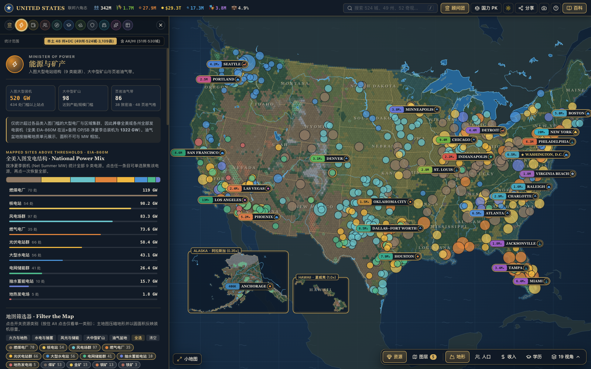
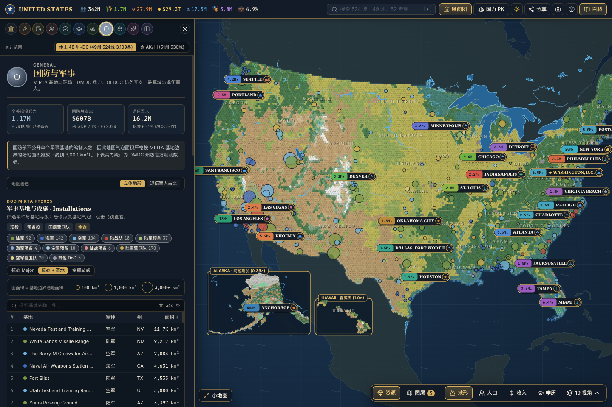
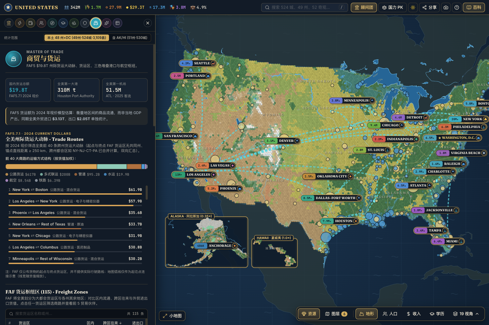
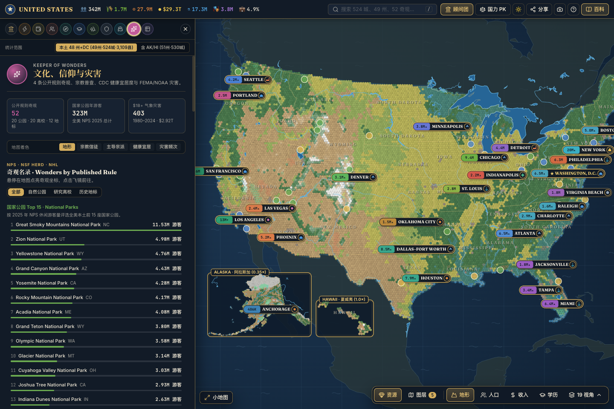

# 《联邦六角志 · TERRA AMERICANA》

> **基于 31 项美国真实联邦公开数据、从零打造的 25 km 等面积六边形《文明》风格策略沙盘与交互式国情探索台**

[](https://www.typescriptlang.org/)
[](https://react.dev/)
[](#)
[-3776AB?logo=python&logoColor=white)](https://docs.astral.sh/uv/)

---

## 实机预览

| 能源与矿产（Energy & Resources） | 国防与军事（Military） |
| :---: | :---: |
|  |  |

| 商贸与货运（Commerce） | 文化、信仰与灾害（Culture） |
| :---: | :---: |
|  |  |

---

## 核心特色

- **100% 真实官方公开数据底座（31 项联邦与学术数据源）**
  通过可复现的 Python 3.12 (`uv`) 离线 ETL 管线直接从官方开放接口与直链下载、解析、清洗并核验全部 **31 项真实数据集**：Census ACS 1-Year / 5-Year / PEP / Boundaries / Gazetteer / OMB CBSA、BEA CAGDP2（全 20 行业 + 弗吉尼亚 23 组 `519xx` 合并市县精确拆算）、BLS QCEW、EIA-860M / Coal / Shale Plays、MSHA、NOAA ETOPO1 & Billion-Dollar Disasters、USGS NLCD（CONUS / AK / HI）、Natural Earth 1:50m & 1:10m、USACE Principal Ports、FAA Enplanements / All-Cargo / BTS NTAD、FHWA/ORNL FAF5.7.1（132 货运区）、DoD MIRTA / DMDC / OLDCC、NSF HERD、NCES IPEDS、NPS Boundaries / Visitor Use / NHL、CDC PLACES、OpenFEMA v2、ARDA/ASARB 2020 U.S. Religion Census。
- **全美 25 km 等面积六边形策略网格 + 双插图框**
  - 美国本土 48 州 + 华盛顿特区采用 `EPSG:5070` 等面积圆锥投影（14,960 格）；
  - 阿拉斯加（`EPSG:3338`，3,265 格）与夏威夷（Hawaii Albers，59 格）以精装黄铜插图框呈现，共 **18,284 块 25 km 六边形** 覆盖全美 **3,144 个县** 与 **530 个都会/微都会区**（默认本土统计口径为 **49 州 · 524 城 · 3,109 县**，顶栏支持一键切换 **含 AK/HI**）。
- **原创「帝国深海羊皮纸暗夜海图 × 2.5D 浮雕沙盘」美学**
  - 默认 **暗夜海图 (`Midnight Cartography`)**，一键切换 **WPA 日光羊皮纸版画 (`Daylight Atlas`)**；
  - **WebGL2 物理挤压六边形浮雕**（真实 ETOPO1 海拔高度、有机手绘色差与边缘倒角）；
  - 全程序化原创微缩图元 Sprite：州纹章色文明风城市横幅（含人口增速箭头与主城区徽章）、10 类等距微缩城区建筑、菱形能源电厂、六角切面矿石晶体、页岩油气点阵地层、邮票奇观与 **「16 人偶 Isotype 劳动力方阵」**。
- **4X 玩法翻译与 10 大编辑级数据工作台**
  - **六大真实产出**：粮食（农林渔牧就业）、产能（制造/建筑/采矿就业）、金币（真实 BEA GDP `$29.30T`）、科技（STEM 与信息业就业 `17.3M`，圣何塞约每 4 人中即有 1 名科研工程人才，全美均值约每 14 人 1 名）、文化（艺文娱乐与教育就业）、信仰（宗教信徒密度）；
  - **19 种数据视角** + 可拖拽框选的 24 格直方图图例；
  - **524 / 530 座都会区指挥视图**（QCEW 区位商 LQ 城区自动落格、16 人偶市民结构对比全美、能源/交通/军事设施、同类城市对标）；
  - **9 位领域内阁顾问（Energy & Resources / Economy / People / Prosperity & Housing / Knowledge / Land / Military / Commerce / Culture）** + **3,109 / 3,144 县全维探索器**（全量窗口虚拟滚动无截断、高 DPI Canvas2D 散点框选联动地图、官方口径注脚与来源徽章）；
  - **双城 / 双州国力 PK 对比模式**（6 维产出雷达图 + 指标擂台 + 劳动力方阵同屏 PK）；
  - **联邦百科全书 (`?`)**：完整公开指标计算公式、奇观评选规则与全部 31 项联邦原始官网直链。

---

## 目录结构

```text
UsaCIV/
├── README.md                    # 项目总览与快速启动指南
├── docs/                        # 设计方案、架构说明、31 项数据源口径与对账验收报告
│   ├── design_plan.md           # 完整产品、视觉、空间网格与 4X 玩法设计方案
│   ├── data_reconciliation.md   # 10 信息页与 31 项联邦数据零偏差对账验收报告
│   └── roadmap_tasks.md         # 全阶段研发与数据验收任务清单
├── pipeline/                    # Python 3.12 (uv) 31 项联邦数据离线采集与空间 ETL 管线
│   ├── config/sources.yaml      # 31 项官方公开数据源清单与元信息
│   ├── pyproject.toml           # Python 依赖声明
│   └── src/usaciv_etl/
│       ├── fetch_all.py         # 自动化下载器（全部官方直链/API）
│       ├── build_all.py         # 空间聚合、4X 玩法翻译、全美对账与 JSON 导出
│       ├── grid/hex_grid.py     # CONUS / AK / HI 等面积 25 km 六边形网格与县域交集矩阵
│       └── spatial/             # 地形/土地覆被、统计表源、电厂/矿山/军事/商贸/奇观解析器
└── web/                         # Vite + React 19 + TypeScript + Tailwind v4 + WebGL2 前端应用
    ├── public/data/             # 预构建的 6 份精简真实数据包（共 ~8.8 MB，开箱即用）
    └── src/
        ├── engine/              # WebGL2 2.5D 六边形引擎、Canvas2D 艺术覆层、微缩 Sprite、拾取与相机
        ├── features/advisors/   # 9 位内阁顾问与 16 类编辑级交互图表原语
        ├── features/explorer/   # 3,109/3,144 县全维探索器（虚拟滚动表 + Canvas 散点）
        ├── features/city/       # 都会区指挥台与 51 州总览
        ├── features/showdown/   # 双城 / 双州国力 PK 对比模式
        └── features/almanac/    # 联邦百科全书与 31 项官方数据源目录
```

---

## 快速启动

### 1. 运行前端（开箱即用，已内置完整 31 源真实数据构建产物）

```bash
cd web
npm install
npm run dev
```

浏览器打开 `http://localhost:5173/` 即可体验；运行 `npm run typecheck && npm run build` 可执行类型检查与生产构建。

### 2. 重新执行 31 项联邦公开数据下载与空间 ETL（可选）

原始数据缓存（约 1.4 GB）默认由 `.gitignore` 排除，如需从联邦官方源头完整重跑：

```bash
cd pipeline
uv sync --python 3.12
PYTHONPATH=src uv run python -m usaciv_etl.fetch_all   # 拉取全部 31 项联邦公开数据源至 data_raw/
PYTHONPATH=src uv run python -m usaciv_etl.build_all   # 生成 25 km 六边形与前端 JSON 数据包至 web/public/data/
```

---

## 文档索引

- [完整产品与视觉架构设计方案](docs/design_plan.md)
- [31 项联邦数据与 10 信息页对账验收报告](docs/data_reconciliation.md)
- [全阶段研发与校验任务清单](docs/roadmap_tasks.md)
