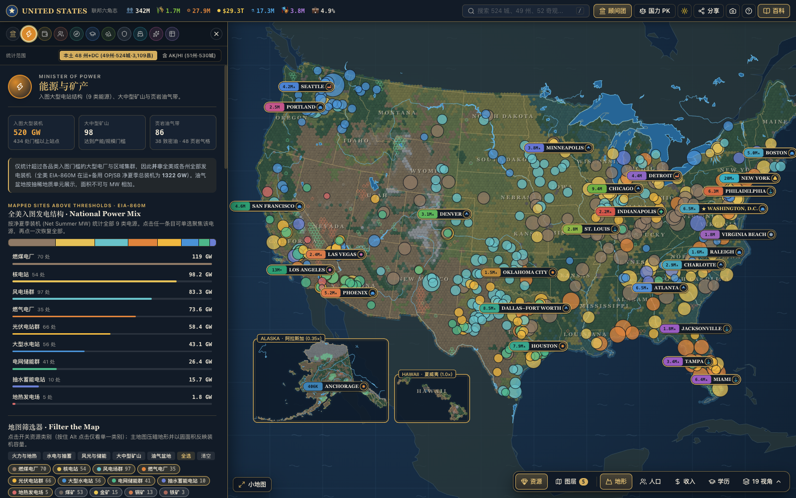
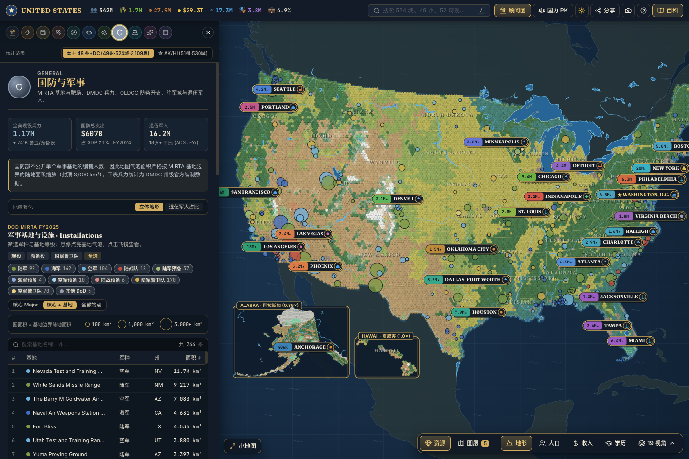
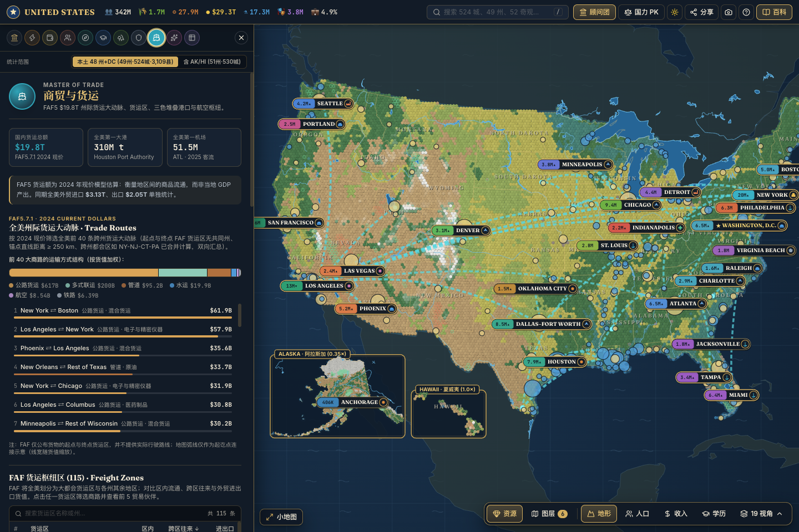
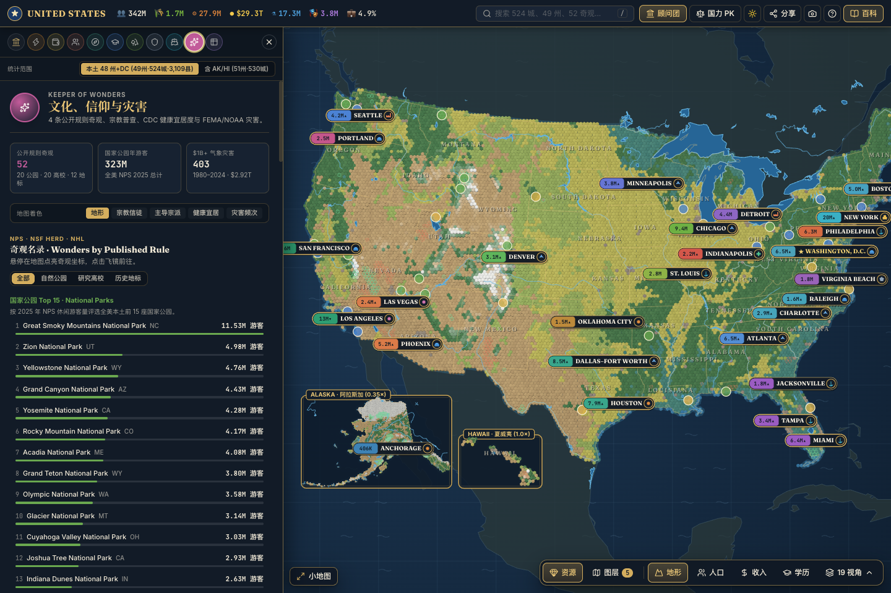

# 《联邦六角志 · TERRA AMERICANA》31 项联邦数据与 10 信息页对账验收报告

本文档记录本地 **31 项美国联邦及学术公开数据源** 经过 Python 离线空间 ETL 独立重算后，在全部 **10 个信息页（9 位领域内阁顾问 + 全维探索器）** 中的统计口径、数据完整度与零截断对账结果。

> **数据原则**：100% 由 `pipeline/src/usaciv_etl/` 基于联邦官方原始文件独立重算，绝不虚构插补缺失州（如 CDC PLACES 缺失 KY/PA、USRC 2020 缺失 CT 均如实留白）。

---

## 一、核心统计口径与验证总表

| 信息页 / 模块 | 核心数据源 | 对账口径与最终验证结果 |
| :--- | :--- | :--- |
| **全局地理口径** | Census CBSA / Gazetteer / ACS | 默认本土 48 州 + DC：**`49 州 / 524 都会区 / 3,109 县`**（含 `16180 Carson City, NV`）；顶栏支持一键切换含 AK/HI（`51 州 / 530 城 / 3,144 县`） |
| **Energy & Resources** | EIA-860M / EIA Coal / MSHA / EIA Shale | **`434` 座门槛电站**（`519.84 GW` 净夏季在运/备用装机，`9` 类电源全部精确对齐；全美总装机 `1,321.6 GW`）、**`98` 座本土大中型矿山**（10 矿种精确对齐）、**`86` 处 1/4 抽稀油气页岩格**（38 致密油 + 48 页岩气）、49 州分电源装机零偏差 |
| **Economy** | BEA CAGDP2 / ACS 1-Yr / BLS QCEW | 全美真实 GDP **`$29.30T`**（`$85.7K/人`），全 20 行业精确增加值；弗吉尼亚 23 组 BEA `519xx` 合并市县按人口精确拆回（Washington, D.C. `$749.1B` / 人均 `$115.9K`），524 都会区 GDP 零偏差 |
| **People** | Census PEP 2021–2025 / ACS 5-Yr | 全美人口 `341.8M`（2021–2025 `+2.92%`），就业 `167.3M`（失业率 `4.88%`），含对数人口密度加权直方图与无截断虚拟滚动明细表 |
| **Prosperity & Housing** | ACS 1-Yr & 5-Yr | 高 DPI Canvas2D 全量渲染全部 3,104 个本土有效县的收入-房价对数散点（含 3× / 5× / 8× 负担线）与全量虚拟滚动表 |
| **Knowledge** | ACS C24030 / 5-Yr / NSF HERD | 全美科研与信息业就业 `17.26M`（`10.3%`），25 万+ 都会区科学产出榜（San Jose `24.9%` / `×2.41`），3,109 县学历-收入散点与宽带鸿沟 |
| **Land** | USGS NLCD 2021 / ACS C24030 | 基于 `R=25 km` 精确正六边形内掩膜 + 最大陆地面积归属州法采样 4,818 格（48 州，DC 合理留空）：森林 `25.4%`、灌木 `22.7%`、草地 `17.1%`、耕地 `17.0%`、湿地 `6.8%`、牧草 `6.5%`、建成区 `3.4%`（DE 耕地精确 `39.5%`）；农林渔牧就业零偏差 |
| **Military** | DoD MIRTA / DMDC / OLDCC / ACS 5-Yr | DMDC 51 州现役 `1.17M` + 警卫/预备役 `741K`（截断至 `UNITED STATES TOTAL` 防止海外格鲁吉亚覆盖佐治亚 `122,386`；科罗拉多 `59,183`）与 OLDCC FY2024 `$606.7B` 全部零偏差；MIRTA 未简化真实面积 `Shape__Area·cos²(lat)`（89 座核心基地、合并 Barry M. Goldwater 7,083 km²、UTTR 归属 `UT`）；**`83` 座本土驻军都会区**（含要塞/驻军与 ⚓ 海军权重）完全对齐 |
| **Commerce** | FHWA FAF5.7.1 / USACE / FAA / BTS NTAD | 国内货运 `$19.79T`（外贸进口 `$3.13T` / 出口 `$2.05T`）；132 货运区合并为 **`115` 个本土 FAF 货运区**（金额零偏差）；基于 OMB `list1_2023.xlsx` CSA 归属与未认领城市锚定生成前 40 条 ≥250 km 跨州大动脉（前 15 条顺序与货值 100% 一致）；**`136` 座本土港口**（零空白州）与 **`368` 座本土机场**（含 8 座非 FAR-139 机场）全量覆盖 |
| **Culture** | NPS / NSF HERD / IPEDS / NHL / USRC / CDC / FEMA / NOAA | **`52` 座公开规则奇观**（15 国家公园 + 5 其他公园单元 + 20 R1 高校 + 12 标志性地标，NPS 年游客 `323,014,305`）；本土口径 CDC PLACES 健康宜居指数（929 个 5 万+ 县零偏差）；2020 宗教普查、OpenFEMA `1,587` 起重大灾害（57 州与领地）及 NOAA `403` 起十亿美元级灾害（`$2,917.6B`）全部零偏差 |
| **Full Explorer** | 全 31 源合并县级宽表 | 全量窗口虚拟滚动无截断（支持 49 州 / 524 城 / 3,109 县，一键切含 AK/HI），55+ 列含市民结构/QCEW/军营，高 DPI Canvas2D 散点框选联动地图与 CSV 导出 |

---

## 二、典型信息页实机 WebGL 渲染预览

| 能源与矿产（Energy & Resources） | 国防与军事（Military） |
| :---: | :---: |
|  |  |

| 商贸与货运（Commerce） | 文化、信仰与灾害（Culture） |
| :---: | :---: |
|  |  |

---

## 三、核心 ETL 模块索引

- [pipeline/config/sources.yaml](../pipeline/config/sources.yaml)：全部 31 项联邦与学术数据源的官网、版本与用途清单
- [pipeline/src/usaciv_etl/fetch_all.py](../pipeline/src/usaciv_etl/fetch_all.py)：31 项数据源自动化拉取脚本
- [pipeline/src/usaciv_etl/spatial/geo_layers.py](../pipeline/src/usaciv_etl/spatial/geo_layers.py)：ETOPO1 海拔、NLCD 正六边形精准土地覆被、Natural Earth 矢量底图与页岩盆地投影
- [pipeline/src/usaciv_etl/spatial/tabular_sources.py](../pipeline/src/usaciv_etl/spatial/tabular_sources.py)：ACS / PEP / BEA（含 VA 519xx 拆算）/ QCEW / CDC PLACES / USRC / FEMA / NOAA / DMDC / OLDCC 解析器
- [pipeline/src/usaciv_etl/spatial/point_layers.py](../pipeline/src/usaciv_etl/spatial/point_layers.py)：EIA-860M 电厂集群、MSHA 矿山、1/4 页岩格、USACE 港口、FAA/NTAD 机场、DoD MIRTA 基地、52 奇观与 FAF5.7.1 货运大动脉解析器
- [pipeline/src/usaciv_etl/build_all.py](../pipeline/src/usaciv_etl/build_all.py)：全美空间汇总、4X 玩法翻译、全美口径审计与 6 份前端精简 JSON 导出
