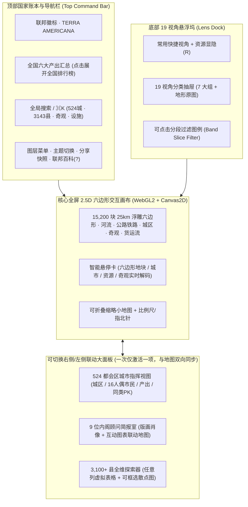
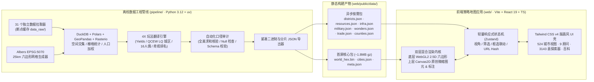

# 《联邦六角志 · TERRA AMERICANA》完整设计方案

> **基于 31 项美国真实公开数据、从零打造的 25 km 六边形 4X 文明策略沙盘**

---

## 一、项目愿景与原创美学宣言

本项目旨在以 **100% 真实、可溯源的美国联邦及学术公开数据** 为底盘，从零构建一款将宏观地理、经济、能源、人口、科研、国防与文化翻译为《文明》式 4X 策略语言的交互式 Web 应用。

在参考既有玩法范式（六边形地块产出、产业城区、真实劳动力市民、公开规则奇观、多维视角、内阁顾问与全县探索器）的基础上，我们在**视觉审美、地图渲染、道具图元、数据管线与交互质感**上坚持彻底的原创设计：

| 维度 | 传统暗黑系策略界面 | 本项目原创设计：《联邦六角志 · TERRA AMERICANA》 |
| :--- | :--- | :--- |
| **美学灵感** | 深海藏青底色 + 鎏金边框 + 平面圆徽章 | **WPA 1930s 美国国家公园丝网版画 × 瑞士山地晕渲 × 2.5D 木刻微缩沙盘** |
| **色彩基调** | 单一深色界面 | 默认 **「日光羊皮纸版画 (Daylight Atlas)」**（暖亚麻纸底 + 普鲁士蓝海域 + 矿物手工颜料），一键切换 **「战情室黄铜夜色 (NORAD Brass)」** |
| **地形表现** | 平面 2D 六边形填色 | **2.5D 物理挤压浮雕（Stepped Bevel Extrusion）+ 西北日光投影**，落基山脉、内华达山脉与阿巴拉契亚山脉依据真实海拔立体隆起 |
| **道具与图元** | 统一圆形小图标 | **“一类要素一种几何语言”**：等距微缩建筑城区、铁路铭牌式城市横幅、菱形能源灯塔、多面体矿石晶体、地质等高线页岩盆地、邮票式奇观印章 |
| **市民呈现** | 静态比例条或文字表格 | 原创 **「16 人偶 Isotype 劳动力方阵」**——致敬奥托·诺伊拉特图形统计法，用 16 枚带职业装备的木棋人偶直观展示圣何塞（4/16 STEM）vs 全美均值（1/16 STEM） |
| **渲染内核** | 纯 2D Canvas 静态整图重绘 | **WebGL2 实例化 2.5D 六边形引擎 + 高清 Canvas2D 程序化微缩图元层**，60–120fps 丝滑缩放与镜头飞行，支持 GPU 级视角渐变 |

---

## 二、真实数据基座：31 项公开数据源与 25 km 六边形网格

### 2.1 25 km 等面积六边形空间底座

为彻底消除墨卡托投影在高纬度地区造成的面积膨胀，本系统全部空间运算均在北美官方等面积投影 **NAD83 / CONUS Albers (`EPSG:5070`)** 下完成：

- **网格规格**：尖顶正六边形（Pointy-Top Axial Coordinates `(q, r)`），中心距 **25 km**（外接圆半径 $R \approx 14.43\text{ km}$，单格真实等面积 **$541.27\text{ km}^2$**）。
- **覆盖范围**：美国本土 48 州 + 华盛顿特区 + 海岸线缓冲水域（约 **15,200 个陆地与滨水六边形**）。*（注：阿拉斯加与夏威夷默认作为可选项在设计确认环节与您对齐是否以插图框形式纳入。）*
- **空间重分配原则（绝不编造数据）**：
  - **总量型指标**（人口、耕地、林地、GDP 等）：按县与六边形交集面积占比（或结合 NLCD 建设用地权重进行人口空间降尺度）精确分摊，确保全美求和与官方发布总数误差 $< 0.1\%$。
  - **比率/中位数指标**（收入、房价、学历、健康、信仰等）：按“交集区域人口权重”加权汇总；无观测数据的区域（如 CDC PLACES 缺失州）严格保留 `null` 并以斜纹灰底明示，**绝不插补造假**。
  - **康涅狄格州口径统一**：针对康州 2022 年起由 8 个传统县改制为 9 个规划区（Planning Regions）的跨期数据错位（影响 2020 宗教普查、历史 FEMA 灾害等），在 ETL 阶段通过几何重叠矩阵自动建立 Crosswalk 并透明注明。

### 2.2 全部 31 项真实公开数据源全景矩阵

离线 Python ETL 管线将自行探索、下载、缓存并解析以下全部 **31 项** 官方公开数据源：

#### A. 基础地理、行政边界与自然地貌（6 项）

| # | 数据源 ID | 官方数据集名称 | 发布机构 | 原始粒度 | 在游戏中的核心用途 |
| :-: | :--- | :--- | :--- | :--- | :--- |
| 1 | `census_boundaries` | Cartographic Boundary Files (1:20M) | U.S. Census Bureau | 州 & 县多边形 | 县→25 km 六边形空间交集、州界/县界绘制 |
| 2 | `census_gazetteer` | Gazetteer Files (Metros, Counties, Places) | U.S. Census Bureau | 点 & 陆水面积 | 陆地/水域精确面积、城市与县权威中心点 |
| 3 | `cbsa_delineation` | Core Based Statistical Area Delineation (OMB 23-01) | Census / OMB | 县→CBSA 映射 | 界定全美 524+ 都会区/微都会区真实疆域版图 |
| 4 | `etopo` | ETOPO1 Global Relief Model (1 arc-min) | NOAA NCEI | ~1.8 km 栅格 | 六边形海拔、地形分级（平原/丘陵/高山）、**2.5D 物理挤压高度** |
| 5 | `nlcd` | National Land Cover Database (NLCD 2021 CONUS) | USGS / MRLC | 30m 栅格（重采样 ~2km） | 森林/农田/草灌/荒漠/湿地/城镇比例、粮食与生产力基础地形、3 项土地视角 |
| 6 | `natural_earth` | Natural Earth v5.1.2 (1:50m) | Natural Earth | 矢量线/面 | 海岸线、五大湖、主要河流（淡水加成）、加墨周边地理背景 |

#### B. 人口、民生、健康与信仰（5 项）

| # | 数据源 ID | 官方数据集名称 | 发布机构 | 原始粒度 | 在游戏中的核心用途 |
| :-: | :--- | :--- | :--- | :--- | :--- |
| 7 | `acs_1yr` | American Community Survey 1-Year Estimates | U.S. Census Bureau | 524 都会区/微都会区 | **524 座城市核心人口、职业结构（市民人偶）、居民行业、收入房价** |
| 8 | `acs_5yr` | American Community Survey 5-Year Estimates | U.S. Census Bureau | 3,100+ 县 | 12 项核心视角（密度/收入/房价/贫困/年龄/移民/学历/宽带/通勤/自有率/医保/退伍军人）+ 全县探索器底表 |
| 9 | `pep_population` | Population Estimates Program (PEP) Vintage Series | U.S. Census Bureau | 县/州年度时序 | 人口增速、自然增长 vs 国内/国际净迁入（城市增长率与人口顾问） |
| 10 | `cdc_places` | PLACES: Local Data for Better Health | CDC | 3,100+ 县 | **宜居度（Amenities）视角与城市幸福度**（4 项成人身心健康指标 Z-score 合成） |
| 11 | `usrc_2020` | 2020 U.S. Religion Census (RCMSCY20) | ASARB / ARDA | 3,100+ 县 | **信仰产出、宗教信徒率视角、第一大宗教传统视角**与文化顾问 |

#### C. 宏观经济、产业城区与立体交通货运（6 项）

| # | 数据源 ID | 官方数据集名称 | 发布机构 | 原始粒度 | 在游戏中的核心用途 |
| :-: | :--- | :--- | :--- | :--- | :--- |
| 12 | `bea_gdp` | GDP by County and Industry (CAGDP2) | U.S. BEA | 3,100+ 县 × NAICS | **金币产出（对应真实 GDP）**、经济顾问、各行业产值结构 |
| 13 | `bls_qcew` | Quarterly Census of Employment & Wages (Annual) | U.S. BLS | 3,100+ 县 × NAICS | **计算区位商（LQ）驱动每座城市的特色城区**（如圣何塞学院、底特律汽车城） |
| 14 | `natural_earth_roads` | Natural Earth v5.1.2 (1:10m Roads & Railroads) | Natural Earth | 矢量线网 | 地图地块改良设施：州际公路网、主干与次级铁路网 |
| 15 | `usace_ports` | Principal Ports of the United States (Tonnage) | USACE / BTS NTAD | 港口点位 + 吞吐吨位 | **航运海港枢纽（Maritime Harbor）**、商贸顾问 |
| 16 | `faa_airports` | FAA Passenger Enplanements, All-Cargo & NASR | FAA / BTS NTAD | 机场点位 + 客货吞吐 | **航空枢纽港（Aero-Hub）**、商贸顾问 |
| 17 | `faf5` | Freight Analysis Framework (FAF5.7.1) | FHWA / BTS / ORNL | 区域间 OD 货运流量 | **洲际货运商路（Trade Routes）动态流向层**、按运输方式与货类拆解 |

#### D. 能源电力与地下矿产资源（4 项）

| # | 数据源 ID | 官方数据集名称 | 发布机构 | 原始粒度 | 在游戏中的核心用途 |
| :-: | :--- | :--- | :--- | :--- | :--- |
| 18 | `eia_860m` | Preliminary Monthly Electric Generator Inventory | U.S. EIA | 发电厂经纬度 + MW | **地图能源资源节点**（核电/光伏/风电/水电/天然气/煤电/储能）与能源顾问 |
| 19 | `eia_coal` | Historical Detailed Coal Production Data | U.S. EIA / MSHA | 煤矿级年产量 | **煤炭战略资源节点**与产能排序 |
| 20 | `eia_shale_plays` | Tight Oil and Shale Gas Plays (Lower 48) | U.S. EIA Energy Atlas | 盆地多边形 | **页岩油气地质层理纹样**（二叠纪、巴肯、马塞勒斯、鹰滩等） |
| 21 | `msha_mines` | Mines Data Set (Open Government Data) | U.S. DOL MSHA | 矿山经纬度 + 矿种 | **金属与非金属矿产晶体节点**（金/铜/铁/锂/银/骨料等） |

#### E. 科研高校、自然公园与历史奇观（5 项）

| # | 数据源 ID | 官方数据集名称 | 发布机构 | 原始粒度 | 在游戏中的核心用途 |
| :-: | :--- | :--- | :--- | :--- | :--- |
| 22 | `herd` | Higher Education R&D (HERD) Survey Microdata | NSF NCSES | 高校级年度研发支出 | **科技产出** + **学术奇观公开评选排名依据** |
| 23 | `ipeds` | IPEDS Directory (HD) & 12-Month Enrollment (DRVEF12) | U.S. DoEd NCES | 高校经纬度 + 在校生 | 高校精准落格坐标、学生规模、大学城城区佐证 |
| 24 | `nps_boundaries` | NPS Land Resources Division Boundaries | National Park Service | 保护区多边形/质心 | 国家公园保护区真实边界图层渲染 |
| 25 | `nps_visits` | NPS Visitor Use Statistics (Recreation Visits) | National Park Service | 公园级年度游客量 | **自然奇观公开评选排名依据** + 文化与旅游产出 |
| 26 | `nhl_landmarks` | National Historic Landmarks (NRHP GIS Subset) | National Park Service | 地标经纬度 | **历史地标奇观**与国家文化遗产节点 |

#### F. 国防军事与气候灾害风险（5 项）

| # | 数据源 ID | 官方数据集名称 | 发布机构 | 原始粒度 | 在游戏中的核心用途 |
| :-: | :--- | :--- | :--- | :--- | :--- |
| 27 | `mirta` | Military Installations, Ranges & Training Areas | DoD OASD(EI&E) DISDI | 基地点/靶场禁区面 | **军事要塞（Fort/Bastion）**、军事禁区斜纹地块、城市军营城区 |
| 28 | `dmdc_personnel` | Military & DoD Civilian Personnel by State/Branch | DoD DMDC | 州 × 军种人数 | 国防顾问兵力构成、各州现役/预备役/文职驻军统计 |
| 29 | `oldcc_spending` | Defense Spending by State (Contracts & Payroll) | DoD OLDCC | 州级国防拨款 | 国防顾问军工经济占比与各州国防合同排行 |
| 30 | `fema_declarations` | OpenFEMA Disaster Declarations Summaries (v2) | FEMA | 县级历史重大灾害记录 | **灾害风险视角**（2000 年至今独立 DR 级重大灾害次数与灾种构成） |
| 31 | `noaa_billions` | U.S. Billion-Dollar Weather & Climate Disasters | NOAA NCEI | 1980–2024 国家级/州级 | 文化与灾害顾问的重大气候灾难经济损失时间线与趋势分析 |

---

## 三、《文明》玩法语言翻译引擎

我们坚持 **“表层是策略直觉，底层是严谨统计”** 的原则：所有游戏化数值都在《联邦百科》与悬停卡片中附带真实物理/经济单位与透明计算公式。

### 3.1 六大核心产出与战略指标

| 策略产出 | 原创徽标色 | 真实数据来源 | 透明换算与玩法含义 |
| :--- | :---: | :--- | :--- |
| **🌾 粮食 (Food)** | 稻麦金 `#C6923A` | NLCD 耕地/牧场 + 河流淡水 + 气候地形 | 衡量农业承载力；沿密西西比河等主要河道地块额外获得 **+1 淡水加成** |
| **⚙️ 生产力 (Production)** | 铸铁红 `#B85A3A` | BEA 制造/建筑/采矿 GDP + 丘陵/林地 + 矿山/电厂 | 工业与实体制造产能，矿山与重工城区提供高额邻接加成 |
| **💰 金币 (Gold)** | 联邦铜金 `#D4A243` | **BEA CAGDP2 真实 GDP** | 直接对应真实地区生产总值（卡片同时显示真实十亿美元 GDP 与归一化策略金币值） |
| **🔬 科技 (Science)** | 蓝图钴蓝 `#2E6DA4` | **NSF HERD 研发支出** + ACS STEM 占比 + 本科率 | 城市科研与创新动能，顶尖研究型大学与科技集群提供显著跃升 |
| **🎭 文化 (Culture)** | 绛红陶紫 `#9A4C73` | **NPS 公园游客量** + NHL 历史地标 + 文娱就业 | 反映景观吸引力、历史积淀与文化影响力 |
| **🕊️ 信仰 (Faith)** | 琉璃青灰 `#5F7E8A` | **2020 U.S. Religion Census 信徒数与占比** | 展示各地区宗教活跃度及最大宗派传统的地理版图 |
| **😊 宜居度 (Amenities)** | 翡翠松绿 `#3D8B68` | **CDC PLACES 四项健康指标 Z-score** | 100 = 全美均值；每优于全美均值 1 个标准差 +10（心理困扰、抑郁、自评欠佳、缺乏运动反向综合） |
| **⚡ 电力 (Power)** | 琥珀电光 `#E08E2B` | **EIA-860M 发电机组装机容量 (MW)** | 城市与区域的能源供给及清洁能源（核/风/光/水）占比 |

### 3.2 产业驱动的十大特色城区（Districts）

基于 **BLS QCEW 就业数据** 计算各都会区在各核心 NAICS 产业上的**区位商（Location Quotient, LQ）**：

$$LQ_{m,i} = \frac{\text{Jobs}_{m,i} / \text{Jobs}_m}{\text{Jobs}_{US,i} / \text{Jobs}_{US}}$$

结合**绝对就业规模下限**（防止极小城镇因单个工厂导致 LQ 虚高）与 **IPEDS / MIRTA / USACE / FAA** 空间实景数据，自动为全美 524 座都会区规划 **1–4 座最具代表性的特色城区**，并将其微缩建筑放置到该都会区周边真实对应的六边形地块上：

1. **研究学院 (Research Campus)**：软件信息、科研服务高 LQ 或顶配 HERD 高校（例：*圣何塞、波士顿、罗利-达勒姆、安娜堡*）
2. **工业铸造与汽车城 (Auto & Heavy Foundry)**：汽车/航空航天/机械制造高 LQ（例：*底特律、西雅图、威奇托、格林维尔*）
3. **金融交易所 (Financial Exchange)**：金融证券、保险总部高 LQ（例：*纽约、夏洛特、芝加哥、哈特福德*）
4. **能源精炼中心 (Energy Refinery)**：油气采掘、石化精炼高 LQ（例：*休斯顿、米德兰、巴吞鲁日、塔尔萨*）
5. **航运海港 (Maritime Harbor)**：USACE 吞吐量头部海港/内河港（例：*洛杉矶-长滩、休斯顿、萨凡纳、新奥尔良*）
6. **航空枢纽港 (Aero-Hub)**：FAA 客运或货运权重头部枢纽（例：*亚特兰大、孟菲斯、路易维尔、达拉斯*）
7. **医疗康养院区 (Medical Pavilion)**：顶级医疗健康产业聚集（例：*罗切斯特 MN、匹兹堡、巴尔的摩*）
8. **娱乐观光长廊 (Grand Promenade)**：文旅住宿、演艺娱乐高 LQ（例：*拉斯维加斯、奥兰多、默特尔比奇*）
9. **联邦/州府议政厅 (Civic Capitol)**：联邦与州公共行政高 LQ（例：*华盛顿特区、萨克拉门托、奥尔巴尼*）
10. **军事要塞营地 (Military Bastion)**：DoD MIRTA 大型现役基地驻地（例：*诺福克、圣迭戈、科罗拉多斯普林斯、基林*）

### 3.3 真实劳动力市民：原创「16 人偶 Isotype 方阵」

在每座都会区的城市视图中，依据 **ACS 1-Year 职业分类数据**，将当地真实劳动力映射为 **4×4 共 16 枚立体木棋人偶（Citizen Meeples）**，每枚代表 $6.25\%$ 的真实就业人口，并按 8 大职业身份佩戴不同几何徽记：

- 🔬 **STEM（工程师/程序员/科学家）** | 🩺 **医疗健康** | 💼 **商管与金融** | 🔧 **制造与建造** | 🚚 **交通与物流** | 🎓 **教育与文创** | 🍽️ **商业与服务** | 🌾 **农林与资源**

> **直观叙事示例**：打开**圣何塞（San Jose）**，16 枚市民人偶中有 **4 枚** 佩戴蓝图护目镜（约 **每 4 名劳动者中有 1 名** 是工程师、程序员或科学家），右侧直接并排对照全美平均的 **1 枚**（约 **每 14 人有 1 名**），无需阅读枯燥表格即可一眼读懂城市的真实灵魂。

### 3.4 公开规则评选的三大类奇观（Open-Rule Wonders）

拒绝人工拍脑袋指定，所有奇观均由**公开、可复算的数据排名规则**生成，并在奇观详情卡中公示其全美排名与量化指标：

- **自然奇观（Natural Wonders, Top 18）**：按 **NPS 2025 年休闲游客访问量** 公开评选（大雾山、大峡谷、锡安、黄石、优胜美地、阿卡迪亚、落基山、冰川等），并在地图上叠加真实保护区边界。
- **学术奇观（Academic Wonders, Top 18）**：按 **NSF HERD 年度高校研发总支出** 公开评选（约翰斯·霍普金斯、加州大学系统旗舰校区、密歇根大学、斯坦福、MIT、宾大、华盛顿大学等），附带 IPEDS 在校生规模与定位坐标。
- **历史地标奇观（Heritage Wonders, Curated 20）**：基于 **NPS National Historic Landmarks** 数据库，按历史时期（建国/工业化/太空时代/工程奇迹）与大区均衡原则公开筛选的标志性建筑与工程遗迹（如独立厅、自由女神像、胡佛水坝、金门大桥、肯尼迪航天中心等）。

---

## 四、原创美术风格、地图渲染与道具设计规范

> **设计红线**：彻底拒绝照搬参考网站的视觉布局、颜色方案、圆形资源徽标与暗蓝界面；建立一套辨识度极高、令人过目不忘的原创美学体系。

### 4.1 视觉主题：「WPA 国家公园版画 × 2.5D 浮雕微缩沙盘」

1. **纸张与颜料质感（Daylight Atlas 默认主题）**：
   - 背景海面与图幅边缘采用**暖调普鲁士浅蓝 (`#C9DBE2` → `#8FB0C2`)** 叠加极细的等深线纹理与微弱纸纹噪点，模拟 1930 年代美国联邦地理测绘局（USGS）铜版印刷与 WPA 海报的高级质感。
   - 陆地生物群落采用低饱和、高和谐度的**天然矿物颜料色系**：
     - 温带森林：松烟橄榄绿 (`#6D8B63`)
     - 耕地与草原：小麦赭黄 (`#D9C589`)
     - 干旱荒漠与峡谷：塞多纳陶土红 (`#D49672`)
     - 高山与雪原：岩石暖灰至峰顶雪白 (`#B8B2A6` → `#F2EFE9`)
     - 湿地与三角洲：青黛沼泽绿 (`#7DA098`)
     - 都市建成区：暖炭石板色 (`#8C8278`) 配极细街区格网纹理
   - **一键切换暗夜模式（NORAD Brass Night）**：深炭黑曜海面 (`#121820`) + 哑光青铜边线 + 柔和磷光数据色带，满足夜间长时间探索与数据投影需求。

2. **2.5D 物理挤压六边形浮雕（WebGL2 核心辨识度）**：
   - 每个 25 km 六边形由顶面六角片 + 南侧 3 个立体斜面（Bevel Sidewall）组成，挤压高度 $h$ 与真实 ETOPO1 海拔非线性映射（平原 $0\text{ px}$、丘陵 $2\text{–}4\text{ px}$、高山 $5\text{–}10\text{ px}$）。
   - 着色器实时计算西北向 $315^\circ$ 日光漫反射与相邻地块高度差产生的微弱环境光遮蔽（AO），使美国大陆地形在任何缩放层级都呈现出精致的**手作木刻沙盘质感**。

### 4.2 原创道具与地图图元体系（Procedural Vector Sprites）

全部地图图标均采用**代码程序化生成的高倍 DPI 等距矢量图元**（支持无损缩放与主题自动换色），彻底抛弃单调圆形代币：

| 地图元素 | 原创几何形态与视觉设计 | 缩放显示层级 (LOD) |
| :--- | :--- | :--- |
| **城市横幅 (City Banner)** | 灵感源自**美国经典州际公路盾牌与铁路站名铜牌**：左侧圆盾嵌真实人口阶梯数字，中段暖白/深墨双拼铭牌写城市名与主力产业印章，底边嵌入精炼的产出微条（金/科/文色点） | L1 显示 Top 35 大都会；L2–L3 按防碰撞优先级渐进展开至全部 524 城 |
| **10 类特色城区 (Districts)** | **2.5D 等距微缩建筑剪影**：如学院=天文穹顶+红砖院落、汽车城=锯齿厂房+双烟囱、金融=Art-Deco 阶梯摩天楼、海港=门座起重机、航空=斜掠塔台、军营=五角星堡 | 放大至区域/都市视角（L2.5–L3）或进入城市视图时立体浮现 |
| **发电厂 (EIA-860M)** | **锐利菱形灯塔（Diamond Beacon）**：核电=钴青双曲冷却塔、光伏=金黄棱镜阵列、风电=纯白三叶风车、水电=弧形大坝、气/煤=琥珀熔炉；菱形尺寸按装机 MW 阶梯缩放 | 资源开关开启时按装机排名逐级呈现 |
| **矿山 (MSHA / EIA Coal)** | **六角切面矿石晶体（Faceted Ore Prism）**：带双面明暗切面（金/铜/铁/锂/煤各具金属色），与菱形电厂形成清晰形状区隔 | L2–L3 显示头部矿区 |
| **页岩油气田 (EIA Shale)** | **地质等高线点阵纹（Geological Stipple Hatch）**：以半透明暖铜斜点纹理覆盖真实盆地六边形，绝不堆砌杂乱图标 | 资源/能源视图下优雅呈现 |
| **三大类奇观 (Wonders)** | **邮票式饰边徽章（Postage Stamp Medallion）**：自然奇观=锯齿邮票+山水版画剪影；学术奇观=象牙白象牙塔+月桂冠；历史地标=青铜古迹碑牌 | 全层级可见核心地标，悬停展开排名卡片 |
| **交通与货运 (Infra & FAF5)** | 州际公路=**双线描边暖赭高速带**；铁路=**经典测绘枕木短划线**；FAF5 商路=**带柔和呼吸虚线的贝塞尔大圆弧线**，线宽对应真实货运美元额 | 地图图层菜单独立一键开关 |
| **军事设施 (DoD MIRTA)** | 基地=**五角星垒盾徽**；大型靶场/训练禁区=**军绿斜线警戒围栏边框** | 军事图层开关控制 |

### 4.3 19 种视角色盲友好科学色带

全部 19 种视角均摒弃刺眼彩虹色，采用经过感知均匀性检验（Perceptually Uniform, 借鉴 Crameri / Okabe-Ito 科学色带）的矿物质渐变，并默认以 **2%–98% 分位截断** 防止少数极端县拉平全国色差：

- **正向递增型**（收入、学历、宽带、宜居度等）：象牙白 → 鼠尾草青 → 深普鲁士蓝
- **财富/密度热力型**（人口密度、房价、建设用地）：暖杏白 → 琥珀橙 → 绛红铁锈
- **风险/警示型**（贫困、无医保、灾害、通勤）：浅灰米 → 陶土橘 → 深绯红
- **生态地类型**（森林=深松绿、农田=麦穗金）
- **分类定性型**（第一大宗教传统）：7 组高区分度手工版画专色（福音派、主流新教、非裔新教、天主教、后期圣徒、东正教、其他）

---

## 五、全功能交互模块设计

### 5.1 空间布局与全局信息架构



### 5.2 19 种视角切换（19 Map Lenses）

按 7 大主题分组组织，支持快捷键 `L` 顺切、图例色段点击过滤（点击某一分位区间即只高亮该区间地块）：

1. **人口 (People)**：`人口密度`、`中位年龄`、`外国出生人口`、`退伍军人占比`
2. **繁荣 (Prosperity)**：`家庭中位收入`、`房价中位数`、`贫困率`
3. **知识 (Knowledge)**：`本科及以上学历`、`宽带普及率`
4. **日常生活 (Daily Life)**：`平均单程通勤`、`住房自有率`、`无医保比例`、`健康宜居指数 (Amenities)`
5. **信仰 (Faith)**：`宗教信徒率`、`第一大宗教传统`
6. **灾害 (Hazards)**：`FEMA 重大灾害累计频次`
7. **土地 (Land)**：`森林覆盖率`、`农田与牧场占比`、`城镇建设用地占比`

*(外加基础地图 `0. 立体自然地形 Terrain`，共 20 种渲染态。)*

### 5.3 524 个都会区城市指挥视图（City Command View）

点击任意都会区横幅或从搜索/排行榜进入，系统执行平滑飞镜动画，**轮廓光勾勒该都会区真实的 CBSA 多六边形版图**，地图外部柔和退为浅雾背景，同时右侧滑出精装版画风格指挥台：

- **顶部城市徽章区**：城市名称、所属州、都会区级别、真实总人口与 PEP 近年人口净增曲线、一键「对比另一座城市」按钮。
- **Tab 1 · 产出与账本**：真实 GDP、人均 GDP、六大产出评分与全美百分位仪表盘。
- **Tab 2 · 产业城区（Districts）**：展示基于 BLS QCEW 区位商生成的特色城区卡片（含精确 LQ 倍数、就业人数与平均年薪），鼠标悬停卡片时地图上的对应 2.5D 微缩建筑脉冲发光。
- **Tab 3 · 市民与劳动力（Citizens）**：原创 **16 枚木棋人偶 Isotype 方阵**，并排展示本地职业结构 vs 全美均值（附精确「每 N 人中有 1 名」对比话术）。
- **Tab 4 · 资源与设施**：列举该都会区辖内所有发电厂（含能源类型堆叠条与总 MW）、矿山、港口、机场、大学与军事基地，点击单项直接定位到所在六边形。
- **Tab 5 · 同类都会区对标（Peers）**：自动匹配人口或 GDP 最相近的 5 座都会区，直观横向对比收入、房价、学历、宜居度与主导产业。

### 5.4 九位内阁顾问简报室（9 Advisors Council）

打开「内阁议事厅（Council）」即可看到 **9 位原创 WPA 木刻版画风顾问卡片**，点选任一位即切换至左侧/右侧停靠的专属数据简报，**顾问内所有图表与地图实现全双向联动**（切换顾问时自动开启对应地图视角、资源筛选或气泡叠层）：

| # | 顾问头衔（原创设定） | 核心覆盖领域与互动图表 | 联动地图视觉 |
| :-: | :--- | :--- | :--- |
| 1 | **财政大臣 · Economy** | 全美及各州/都会区真实 GDP 行业构成、头部产值排行、制造业/科技/金融龙头 | 都会区 GDP 气泡 + 经济高亮 |
| 2 | **能源矿产总署 · Energy** | EIA-860M 发电能源结构拆解（可点击单一能源筛选全国电厂）、煤炭与金属矿产排行 | 仅保留对应能源菱形灯塔 + 页岩盆地层 |
| 3 | **人口统计官 · People** | 人口密度分布、PEP 近年增长最快/萎缩最快的都会区与县、老龄化与移民版图 | 切换人口密度/年龄/移民视角 + 增长热点圈 |
| 4 | **民生与住房司 · Prosperity** | 收入与房价负担比（Price-to-Income）分布、贫困与无医保区域诊断 | 切换收入/房价/贫困视角 |
| 5 | **首席学者 · Knowledge** | 高校 HERD 研发 Top 榜单、学历与宽带鸿沟、STEM 劳动力高地 | 切换学历/宽带视角 + 学术奇观高亮 |
| 6 | **土地测绘长 · Land** | 全美地表覆被构成（林/农/草/漠/城）、海拔梯级分布、农业大州排行 | 切换森林/农田/建设用地视角 |
| 7 | **国防总司令 · Military** | DMDC 各军种兵力条形图、OLDCC 各州国防开支、大型基地与靶场名录、退伍军人分布 | 强化军事要塞与禁区边界 + 退伍军人视角 |
| 8 | **商贸与航运总监 · Commerce** | FAF5 州际前 40 大货运走廊排行（按货值/吨位/运输方式筛选）、港口与航空枢纽榜单 | 自动点亮州际货运弧线 + 海空枢纽图标 |
| 9 | **文化与应急总管 · Culture & Hazards** | 三大奇观名录、宗教传统版图、CDC 宜居度排行、FEMA 灾害与 NOAA 十亿美元级灾难时间线 | 联动信仰/宜居度/灾害视角与奇观印章 |

### 5.5 全美 3,100+ 县全维探索器（Cartographic Explorer）

探索器作为独立的第 10 席「制图师工作台（Cartographer's Explorer）」，把全美 **3,143 个县**（同时支持切换至 **524 个都会区** 或 **49 个州/特区** 粒度）的 **40+ 项真实统计字段** 完整交给用户自由切片：

- **可定制虚拟化数据表（Virtualized Table）**：
  - 使用 `@tanstack/react-virtual` 实现 3,143 行零卡顿流畅滚动；
  - 自由勾选显示列、多列排序、按州/地区筛选、关键词搜索、一键导出筛选结果为 CSV。
- **高交互 Canvas/SVG 散点图与直方图**：
  - 任意指定 **X 轴、Y 轴、气泡大小列、颜色分组列**；
  - 支持**线性 / 对数坐标轴切换**、实时计算 **皮尔逊相关系数 $r$ / $R^2$ 与 OLS 回归趋势线**、中位数四象限参考线；
  - 内置 6–8 个“一键好奇预设”（例如：*收入 vs 健康宜居度*、*学历 vs 房价*、*宗教信徒率 vs 贫困率*、*灾害频次 vs 人口增速*），降低上手门槛。
- **真·双向地图联动（Two-Way Linked Brushing）**：
  - **图→地**：在散点图上直接拖拽**矩形框选或套索选区**，被框中的几十或几百个县瞬间在主地图上高亮描边并压暗其余区域，同时底部实时统计选中子集的均值与总人口！
  - **表→地**：悬停表格任意行，地图实时弹出该县高亮光环；点击行直接飞镜聚焦。
  - **地→图/表**：在主地图上点击或框选任意区域，散点图同步点亮对应散点，表格自动滚动并置顶选中县。

### 5.6 联邦百科全书（Federal Almanac, `?`）

点击顶部问号即可打开精装百科弹窗，包含：
- 游戏语言对照表（每一项产出、城区、奇观、市民人偶背后的真实计算公式）；
- **全部 31 个数据源完整名录**：官方标题、发布机构、数据年份（Vintage）、直接可点击的官网原链接、原始空间粒度与已知数据边界声明（如康州规划区、CDC 缺失州）。

---

## 六、全栈技术架构与工程规范

### 6.1 端到端系统架构



### 6.2 为什么选择「WebGL2 + Canvas2D 混合渲染内核」？

1. **WebGL2 实例化六边形底盘（~450 行 TypeScript + GLSL）**：
   - 将 15,200 个六边形的中心坐标 `(x, y)`、真实海拔 `elev`、生物群落编码与当前视角数值直接上传为 GPU 实例属性缓冲（Instance Buffer）。
   - 切换 19 种视角或拖拽散点图框选全美 3,143 个县时，仅更新一个 $15200 \times 4\text{ bytes} \approx 60\text{ KB}$ 的 `Float32Array` 缓冲区，GPU 在 **$< 0.5\text{ ms}$** 内完成全美重着色、2.5D 浮雕挤压与高亮动画，彻底杜绝纯 Canvas2D 每次切视角重绘 15,000 个多边形的卡顿！
2. **高 DPI Canvas2D 图元与标注覆层**：
   - 预烘焙一套高分辨率的**原创程序化微缩建筑与道具图集（Procedural Sprite Atlas）**，支持日光版画/暗夜双主题动态重渲染。
   - 在 Canvas2D 层绘制清晰的矢量河流、州界、双线高速公路、枕木铁路、动态货运流向弧线，以及经过贪心边界盒防重叠算法排版的铁路铭牌式城市横幅，保证任何缩放级别下文字锐利无模糊。
3. **极速空间拾取**：
   - 鼠标移动时通过数学公式 $O(1)$ 反算当前指针所在的轴坐标六边形 `(q, r)`；
   - 城市横幅、能源矿产与奇观采用轻量化空间网格索引（Spatial Hash），确保 60fps 悬停反馈无延迟。

### 6.3 项目代码目录规划

```text
UsaCIV/
├── pipeline/                        # Python 3.12 (uv) 离线数据管线
│   ├── pyproject.toml               # duckdb, polars, geopandas, shapely, rasterio, httpx, pydantic
│   ├── config/sources.yaml          # 31 项数据源官方 URL、年份与校验元数据
│   ├── src/usaciv_etl/
│   │   ├── fetchers/                # 31 个数据源模块化下载与解析器（支持离线断点续传）
│   │   ├── grid/hex_grid.py         # EPSG:5070 25km 六边形网格 & 县-格交集权重矩阵
│   │   ├── spatial/                 # NLCD 栅格统计、ETOPO1 海拔提取、河网/路网拓扑简化
│   │   ├── game/                    # Yields、QCEW 城区 LQ、16人偶市民、公开规则奇观引擎
│   │   ├── audit/reconcile.py       # 自动化数据完整性与全美口径对账测试
│   │   └── export/bundle.py         # 导出紧凑二进制/分片 JSON 至 web/public/data/
│   └── data_raw/                    # 本地原始数据缓存（.gitignore）
│
├── web/                             # Vite + React 19 + TypeScript 前端应用
│   ├── public/data/                 # 由 pipeline 生成的真实数据产物
│   ├── src/
│   │   ├── engine/
│   │   │   ├── camera.ts            # 惯性拖拽、双指缩放、平滑飞镜、边界钳制
│   │   │   ├── webgl/HexRenderer.ts # WebGL2 2.5D 浮雕六边形与视角渐变着色器
│   │   │   ├── sprites/             # 原创程序化微缩建筑、道具、邮票奇观、人偶绘制器
│   │   │   ├── overlay/             # 河流/国界/路网/货运弧线/防重叠城市铭牌绘制层
│   │   │   └── picking.ts           # O(1) 六边形反算 + 图标空间命中检测
│   │   ├── features/
│   │   │   ├── lenses/              # 19 种视角定义、科学色带、图例分段过滤
│   │   │   ├── city/                # 524 都会区指挥视图 + 16人偶方阵 + 城市对标 PK
│   │   │   ├── advisors/            # 9 位版画风顾问面板 + 地图双向联动图表
│   │   │   ├── explorer/            # 3,143 县虚拟表格 + 可框选散点图 + 地图联动
│   │   │   └── almanac/             # 联邦百科全书（公式阐释 + 31 项真实源链接）
│   │   ├── store/useAppStore.ts     # 全局状态与 URL Hash 持久化
│   │   └── styles/theme.css         # 日光版画 & 战情暗夜双主题 Design Tokens
│   └── tests/                       # 单元与 E2E 渲染/联动自动化测试
└── docs/                            # 数据契约文档与算法说明
```

---

## 七、分阶段开发与验证路线图

| 阶段 | 核心交付里程碑 | 关键验证标准 |
| :--- | :--- | :--- |
| **Phase 1：数据底盘与 31 源 ETL 管线** | 跑通 25 km Albers 六边形网格与全部 31 个真实公开数据源的自动拉取、解析、空间重分配、城区 LQ 计算、16 人偶市民统计与奇观评选；生成完整前端数据包。 | 自动化对账脚本通过：全美人口/GDP 总和与官方偏差 $<0.1\%$；524 都会区与 3,143 县字段完整；无静默插补造假。 |
| **Phase 2：原创 2.5D 浮雕地图引擎与 19 视角** | 搭建 Vite+React+TS 壳与 WebGL2 2.5D 挤压六边形渲染器、日光版画/暗夜双主题、原创程序化微缩建筑/能源矿产/奇观图元、6 类静态图层开关及全部 19 种视角 + 分段过滤图例。 | 缩放/平移稳定 60fps；19 视角切换无闪烁掉帧；首屏核心数据 gzip $<2.5\text{ MB}$；各缩放层级标注清晰不重叠。 |
| **Phase 3：524 都会区指挥视图与联邦百科** | 完成飞镜聚焦都会区版图、城区微缩建筑真实落格放置、16 人偶 Isotype 劳动力方阵、同类城市 PK 与完整《联邦百科全书》（含 31 个官网直链与规则公示）。 | 随机抽检圣何塞（1/4 STEM + 学院）、底特律（汽车铸造城）、纽约（金融交易所）、休斯顿（能源+海港）数据与视觉完全吻合。 |
| **Phase 4：9 位顾问简报室 & 3,100+ 县探索器** | 完成全部 9 位原创版画风顾问面板（图表-地图双向联动）以及 3,143 县任意列虚拟表格 + 可拖拽框选散点图 + 地图实时联动高亮。 | 3,143 县散点图框选与地图联动延迟 $<16\text{ ms}$；9 位顾问无死链空图表；表格排序筛选与 CSV 导出正常。 |
| **Phase 5：打磨、分享导出与可选策略玩法** | URL Hash 完整状态分享、高清海报级地图截图导出、快捷键体系、移动端/窄屏适配，以及（按您选择）接入轻量可玩策略拓展模式（双城对决/迷雾猜城挑战）。 | 全链路浏览器自动化测试（Playwright）通过，控制台零报错，多分辨率视觉验收通过。 |

---

## 八、已确认的关键设计决策（设计定稿）

1. **视觉主色调**：采用 **「WPA 日光羊皮纸版画默认 (`Daylight Atlas`) + 一键切换战情暗夜 (`NORAD Brass Night`)」**。
2. **地理版图范围**：主体聚焦 **美国本土 48 州 + 华盛顿特区（CONUS, `EPSG:5070` 25 km 等面积六边形）**，同时在地图左下角通过独立精装黄铜插图框纳入 **阿拉斯加（`EPSG:3338`）与夏威夷（Hawaii Albers）**，实现全美 50 州 + 特区全覆盖。
3. **一期可玩性定位**：极致精装的 **4X 真实数据策略沙盘** + **双城 / 双州国力 PK 对比模式**（支持任意两座都会区或两个州进行六大产出、真实 GDP、城区结构与 16 人偶劳动力同屏对决）。
4. **数据源采集规范**：全部 31 项真实数据源优先通过官方公开 API / 直链自动拉取与缓存；若个别站点存在人工表单或访问门槛，绝不绕过任何访问控制，立即向用户汇报需手工下载的单文件链接。
